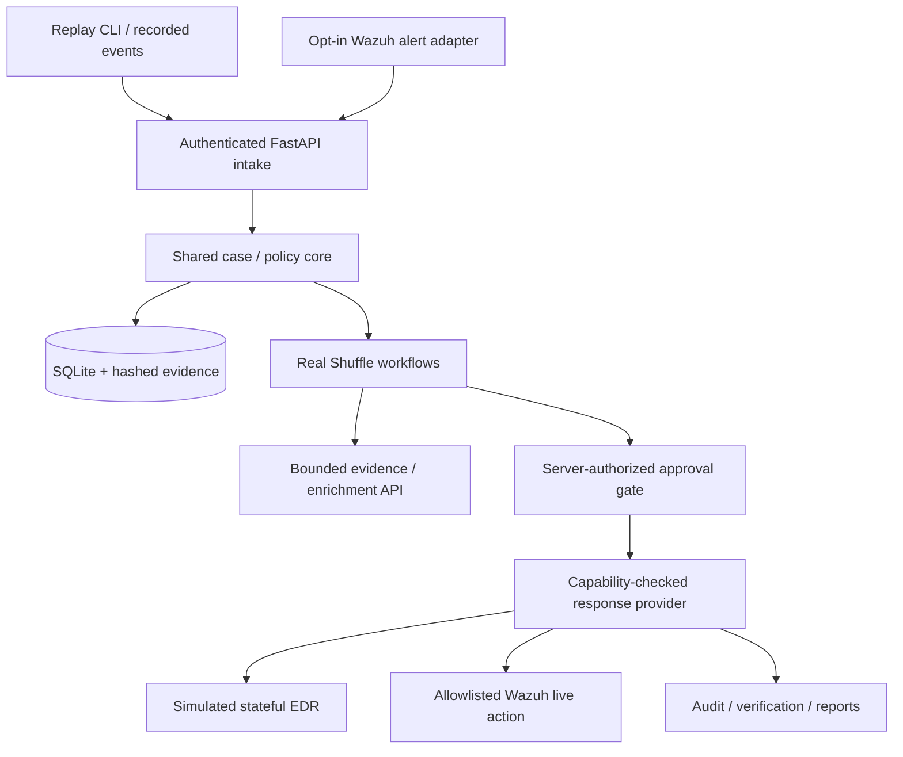

# Architecture

Status: direction accepted from owner requirements; RF-01 contracts and pure policy implemented. Runtime components remain unimplemented.

One deployable Python application contains API, domain logic, adapters and replay CLI; SQLite persists cases, approvals, idempotency and audit with migrations. Shuffle owns orchestration, branches and retries. Wazuh retains detection/endpoint responsibilities; its indexer/dashboard are confined to the optional live profile. Velociraptor is deferred until after required replay and live releases.

Replay queries only evidence actually recorded in a bounded scenario/endpoint/time scope. Missing evidence stays unavailable. Response capabilities are explicit and provider/version specific. Wazuh active response does not imply network isolation. The core validates all state transitions and is the final authority for approvals and dispatch even if a workflow is misconfigured.

## RF-01 contracts

The [frozen RF-01 design](rf-01-design.md) defines versioned Pydantic schemas: Alert, Incident, Evidence, Enrichment, PlaybookRun, ActionProposal, Approval, ActionExecution and AuditEvent. UTC observed and ingestion times remain separate. Durable IDs correlate callbacks, reports and actions. Authenticated endpoints include intake, cases/evidence, proposal/approve/reject/execute/status, report and Shuffle callback. Health/readiness disclose service readiness without claiming enrolled endpoint readiness.

Incident states are `RECEIVED → TRIAGING → INVESTIGATING → AWAITING_APPROVAL → RESPONDING → CONTAINED | RESOLVED | FAILED`, with `CLOSED` only after review of a final state. Approval cancellation/expiry and dispatch/ack/effect/rollback states are distinct. Idempotency aims at one observable effect, not a distributed exactly-once guarantee. Unknown provider outcomes require reconciliation before another dispatch.

## Decision register

| Decision | State | Record |
| --- | --- | --- |
| One Python package, SQLite, shared replay/live core | Accepted from handoff | [ADR 0001](decisions/0001-bounded-core.md) |
| Integration version/digest lock and native architecture support | Pending runtime qualification | [Dependencies](dependencies.md) |
| Safe Shuffle worker execution without default Docker socket | Blocking deployment design question | [Plan RF-04](implementation-plan.md) |
| Project license | Owner decision pending | [Limitations](limitations.md) |

No Compose file is supplied until a supported, secure configuration is validated. Docker reproducibility is a delivery gate, not established by a diagram.
