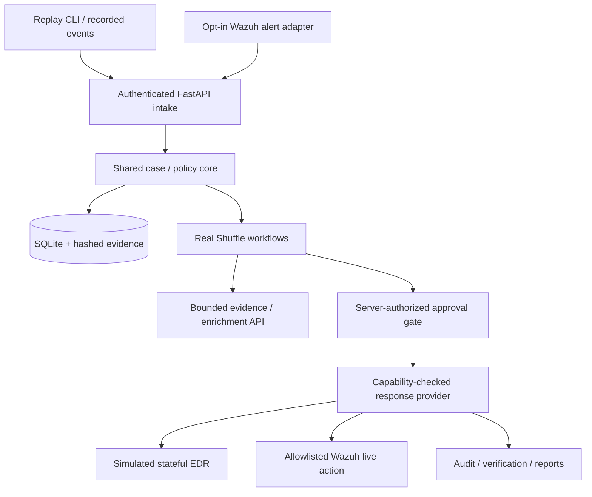

# Architecture

Status: direction accepted from owner requirements; RF-01 contracts and RF-02 authenticated API/SQLite core implemented; see [RF-02 evidence](rf-02-ledger.md). RF-03 replay/report and simulated response are merged and verified; RF-04A source-derived transport/planning is merged and verified; RF-04B callback/safety corrections are in progress, vendor runtime remains open.

One deployable Python application contains API, domain logic, adapters and replay CLI; SQLite persists cases, approvals, idempotency and audit with migrations. Shuffle owns orchestration, branches and retries. Wazuh retains detection/endpoint responsibilities; its indexer/dashboard are confined to the optional live profile. Velociraptor is deferred until after required replay and live releases.

Replay queries only evidence actually recorded in a bounded scenario/endpoint/time scope. Missing evidence stays unavailable. Response capabilities are explicit and provider/version specific. Wazuh active response does not imply network isolation. The core validates all state transitions and is the final authority for approvals and dispatch even if a workflow is misconfigured.

## RF-01 contracts

The [frozen RF-01 design](rf-01-design.md) defines versioned Pydantic schemas: Alert, Incident, Evidence, Enrichment, PlaybookRun, ActionProposal, Approval, ActionExecution and AuditEvent. UTC observed and ingestion times remain separate. Durable IDs correlate callbacks, reports and actions. Authenticated endpoints include intake, cases/evidence, proposal/approve/reject/execute/status, report and Shuffle callback. Health/readiness disclose service readiness without claiming enrolled endpoint readiness.

Incident states are `RECEIVED → TRIAGING → INVESTIGATING → AWAITING_APPROVAL → RESPONDING → CONTAINED | RESOLVED | FAILED`, with `CLOSED` only after review of a final state. Approval cancellation/expiry and dispatch/ack/effect/rollback states are distinct. Idempotency aims at one observable effect, not a distributed exactly-once guarantee. Unknown provider outcomes require reconciliation before another dispatch.

## Decision register

| Decision | State | Record |
| --- | --- | --- |
| One Python package, SQLite, shared replay/live core | Accepted from handoff | [ADR 0001](decisions/0001-bounded-core.md) |
| Integration version/digest lock and native architecture support | Pending runtime qualification | [Dependencies](dependencies.md) |
| Shuffle execution-plane authority | Docker Desktop pilot selected; VM option retained; execution grant pending | [ADR0002](decisions/0002-shuffle-execution-boundary.md) |
| Project license | Owner decision pending | [Limitations](limitations.md) |

The [RF-02 durable design](rf-02-design.md) implements short SQLite transactions, persistent approval snapshots and dispatch reservations. Provider I/O occurs outside transactions; uncertain reservations suppress redispatch and reconcile only through verification. Internal OpenAPI is published, with no claim of vendor-schema compatibility. Actual Shuffle and endpoint integrations still require independent runtime proof.

RF-04A retains historical blocked planning-only Compose. The [runtime implementation](rf-04-runtime-design.md) separately builds pinned reviewed sources and renders a checked, explicitly authorized pilot; its [ledger](rf-04-runtime-ledger.md) owns actual runtime qualification. Docker reproducibility is established by observed builds/recovery, not a diagram.

The [RF-03 design](rf-03-design.md) binds replay alerts/evidence to source bytes and scope, uses a separate SQLite file for durable simulated endpoint state, and produces one authorized, default-redacted report snapshot. The in-process HTTP driver exercises common core authentication/approval/recovery without implying genuine SOAR orchestration. Actual Shuffle and recorded-source qualification remain distinct.

[RF-04A](rf-04-design.md) adds a source-derived vendor client and durable workflow launch coordinator in the same Python package. Outbound reservations use namespaced records in the existing private callbacks collection and do not modify RF-01 contracts or reset case schema. Coordinator terminal delivery attribution requires exact source/case/run/workflow/argument and executed-graph binding. Coordinated runs record authenticated node callbacks separately and remain running until reconciliation also verifies the executed vendor graph, native callback result and matching terminal outcome. Missing or conflicting observations remain uncertain; standalone analyst-registered legacy runs retain direct callback semantics. Workflow status never establishes endpoint effect.
