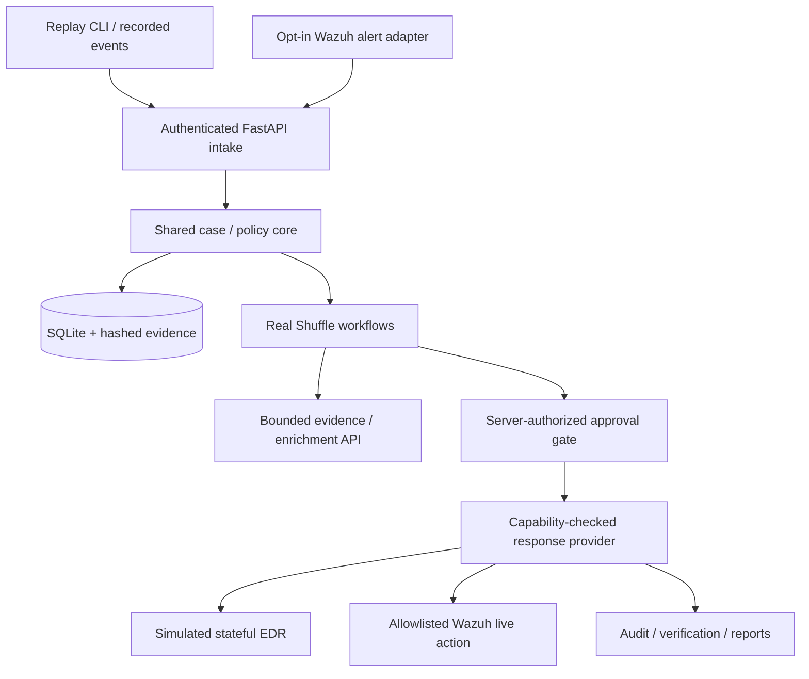

# Architecture

Status: direction accepted from owner requirements; RF-01 contracts and RF-02 authenticated API/SQLite core implemented; see [RF-02 evidence](rf-02-ledger.md). RF-03 replay/report and simulated response are merged and verified; RF-04A source-derived transport/planning is merged and verified; RF-04 runtime is merged and bounded Docker Desktop transport qualified; RF-05A domain steps are merged and verified; RF-05B native graphs are runtime-qualified on Docker Desktop and merged as `ec5d80e`, with actual merged-revision offline checks passing. RF-06B2 is merged as2f5e204 with actual merged-revision checks passing; five narrowed recorded scenarios are qualified. RF-07A native Wazuh intake is under design, with no live endpoint claim.

One deployable Python application contains API, domain logic, adapters and replay CLI; SQLite persists cases, approvals, idempotency and audit with migrations. Shuffle owns orchestration, branches and retries. Wazuh retains detection/endpoint responsibilities; its indexer/dashboard are confined to the optional live profile. Velociraptor is deferred until after required replay and live releases.

Replay queries only evidence actually recorded in a bounded scenario/endpoint/time scope. Missing evidence stays unavailable. Response capabilities are explicit and provider/version specific. Wazuh active response does not imply network isolation. The core validates all state transitions and is the final authority for approvals and dispatch even if a workflow is misconfigured.

## RF-01 contracts

The [frozen RF-01 design](rf-01-design.md) defines versioned Pydantic schemas: Alert, Incident, Evidence, Enrichment, PlaybookRun, ActionProposal, Approval, ActionExecution and AuditEvent. UTC observed and ingestion times remain separate. Durable IDs correlate callbacks, reports and actions. Authenticated endpoints include intake, cases/evidence, proposal/approve/reject/execute/status, report and Shuffle callback. Health/readiness disclose service readiness without claiming enrolled endpoint readiness.

Incident states are `RECEIVED → TRIAGING → INVESTIGATING → AWAITING_APPROVAL → RESPONDING → CONTAINED | RESOLVED | FAILED`, with `CLOSED` only after review of a final state. Approval cancellation/expiry and dispatch/ack/effect/rollback states are distinct. Idempotency aims at one observable effect, not a distributed exactly-once guarantee. Unknown provider outcomes require reconciliation before another dispatch.

## Decision register

| Decision | State | Record |
| --- | --- | --- |
| One Python package, SQLite, shared replay/live core | Accepted from handoff | [ADR 0001](decisions/0001-bounded-core.md) |
| Integration version/digest lock and native architecture support | Pending runtime qualification | [Dependencies](dependencies.md) |
| Shuffle execution-plane authority | Scoped Docker Desktop pilot explicitly authorized and qualified; VM option retained | [ADR0002](decisions/0002-shuffle-execution-boundary.md) |
| Project license | Owner decision pending | [Limitations](limitations.md) |

The [RF-02 durable design](rf-02-design.md) implements short SQLite transactions, persistent approval snapshots and dispatch reservations. Provider I/O occurs outside transactions; uncertain reservations suppress redispatch and reconcile only through verification. Internal OpenAPI is published, with no claim of vendor-schema compatibility. Actual Shuffle and endpoint integrations still require independent runtime proof.

RF-04A retains historical blocked planning-only Compose. The [runtime implementation](rf-04-runtime-design.md) separately builds pinned reviewed sources and renders a checked, explicitly authorized pilot; its [ledger](rf-04-runtime-ledger.md) owns actual runtime qualification. Docker reproducibility is established by observed builds/recovery, not a diagram.

The [RF-03 design](rf-03-design.md) binds replay alerts/evidence to source bytes and scope, uses a separate SQLite file for durable simulated endpoint state, and produces one authorized, default-redacted report snapshot. The in-process HTTP driver exercises common core authentication/approval/recovery without implying genuine SOAR orchestration. Actual Shuffle and recorded-source qualification remain distinct.

[RF-04A](rf-04-design.md) adds a source-derived vendor client and durable workflow launch coordinator in the same Python package. Outbound reservations use namespaced records in the existing private callbacks collection and do not modify RF-01 contracts or reset case schema. Coordinator terminal delivery attribution requires exact source/case/run/workflow/argument and executed-graph binding. Coordinated runs record authenticated node callbacks separately and remain running until reconciliation also verifies the executed vendor graph, native callback result and matching terminal outcome. Missing or conflicting observations remain uncertain; standalone analyst-registered legacy runs retain direct callback semantics. Workflow status never establishes endpoint effect.

[RF-05A](rf-05-design.md) adds a bound step facade over the same core, with server-selected evidence/target/provider and separate technical analyst/executor principals. Workflow credentials cannot approve or inherit human authority. The source-grounded prepare/gate/dispatch interfaces preserve existing approval, capability, idempotency and verification semantics; actual Shuffle orchestration is the RF-05B runtime gate.

[RF-05B](rf-05b-design.md) supplies the fixed SDKless native task app and three four-node Shuffle graphs. Shuffle schedules and persists orchestration; source-bound core steps retain evidence, policy, technical principal scopes, human decisions and verified effects. Native task proof and the authenticated final callback must agree with the original vendor graph. A private opt-in replay-only file configuration registers the original fixture and durable mock; live mode cannot instantiate it. [Actual qualification](rf-05b-ledger.md) is bounded to the tested ARM64 Desktop engine and simulated effects.

[RF-06A](rf-06-design.md) adds explicit selective acquisition and a bounded recorded Sysmon Event1 projection in the same package. Original source bytes/hash, event identity and distinct logging/process times remain traceable; recorded provenance survives core evidence validation and cached plans without a synthetic label. Default fixture/lab configuration stays original-fixture-only. No source-specific policy, new provider or runtime deployment is implied; five-scenario native qualification remains RF-06B.

[RF-06B1](rf-06b-design.md) extends explicit Windows projections and recorded-observation policy in the same package. Channel-scoped event/evidence identities preserve raw record IDs; subsets retain source/hash/selection provenance. Existing approvals, capabilities and durable effects remain authoritative. Access/task observations escalate; file/DNS associations never invent process creation. Safe report labels disclose matched full/subset registered source. XML sources remain programmatic/inspection-only until RF-06B2 runtime preparation and genuine qualification.

[RF-06B2](rf-06b2-design.md) registers immutable exact-source replay batches and selects the same durable mock adapter through a server-owned qualification/database alias. Full source resolution applies to collection, plans, atomic dispatch and reports; unknown/conflicting scope fails closed. A default-false read-only core mount holds privately prepared pinned bundles. Genuine native Prepare creates plans; authenticated read-only inspection cannot recreate them. The [runtime runbook](recorded-runtime.md) and [owning ledger](rf-06-ledger.md) distinguish source/build identities, first candidate results and final qualification/owner gates. No new live provider or topology authority is implied.

[RF-07A](rf-07-design.md) adds bounded authenticated native Wazuh alert intake in the same package and common SQLite case transaction. Trusted manager/agent bindings select canonical endpoints; exact received delivery bytes and original IDs/times remain private and hash-bound. Source credentials cannot call generic intake as Wazuh or acquire approval/dispatch authority. Available delivery provenance and explicit missing endpoint evidence do not imply a live collection/response capability. The [operator notes](wazuh.md) keep source mode, dry-run, raw retention and future deployment/enrollment/live verification separate.

[RF-07B](rf-07b-design.md) adds private immutable sender/outbox recovery and offline deployment/enrollment preparation in the same package. A separately reviewed source correction is required for the pinned dashboard manager-API TLS bypass; the optional plan remains ready=False. Windows package hash/signer/target/ACL/reservation controls do not establish enrolled endpoint or verified action proof. [Operator preparation](wazuh-preparation.md) separates byte acquisition, source metadata, portable control-path tests and native runtime qualification.
